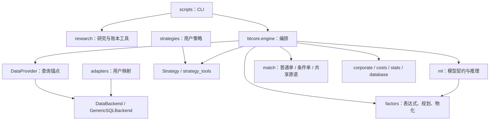

# ddup 架构与设计契约

本文解释机制如何组合及边界为何存在。接口字段分别由[后端](docs/backend_guide.md)、
[因子](docs/factor_library.md)、[策略](docs/strategy_guide.md)、[ML](docs/ml_guide.md)、
[结果](docs/results_analysis.md)、[账本](docs/live_guide.md)指南维护；目录归属见
[repository_layout.md](docs/repository_layout.md)。定位源码用模块 + 符号，不固定行号。

<a id="layers"></a>
## 分层与扩展点



依赖箭头表示使用方向，不是所有 import 的枚举。内核不 import 用户层；策略、因子和
后端声明意图或数据，引擎负责通用机制。`research.factor_eval/composite` 是纯计算，
报告/归因涉及文件与数据库，`research.live` 还编排引擎回放。

| 模块与符号 | 责任与设计理由 |
| --- | --- |
| `engine.Engine.run/prepare/step/compute_pending` | 拆开准备、撮合、决策，使回测与实盘回放共享决策语义 |
| `provider.DataProvider` | 数据查询锚点；attach_bars 后历史查询切预载面板，避免逐日回源 |
| `backend.DataBackend` | 仅强制行情/日历/分红三接口；可选能力 getattr 探测 |
| `generic_sql.GenericSQLBackend` | 表单编译、schema/键校验、外并集拼表、列裁剪；用户不用复制 SQL 机制 |
| `strategy_loader.load_strategy/build_strategy` | YAML/dict 统一装配因子闭包、过滤、模型与条件单 |
| `strategy.Strategy` | 声明式属性与钩子；调仓节奏由 select 自管 |
| `strategy_tools.eval_factor_specs/ConditionBuilder` | 截面排名评分；条件单生成与 trailing 状态 |
| `filters.StockFilter/resolve_index_snapshots` | 可选过滤、指数成分缓存；过滤由策略显式调用 |
| `factors.expr/ops` | 无函数表达式走 numexpr；算子表达式走 AST 白名单；固定算子表 |
| `factors.library/plan/cse` | DAG 闭包、依赖列/warmup、两路供给、公共子表达式共享 |
| `ml.spec/dataset/runtime` | meta 特征契约、训练面板、panel/holding 推理；分数不带引擎硬编码意图 |
| `ml.labels/trainer/metrics/export/conditions` | 标签、时间切分、评估、ONNX 导出与 ML_EXIT |
| `match.manual/conditions/core` | 普通单与条件单互不依赖，共用价格/量/现金/结算原语 |
| `corporate.adjust/apply_condition_rescale` | 用明确分红事件调整股数/成本/价格与 trailing 锚点 |
| `limits/costs/slippage` | 精确涨跌停优先，费用闭包，固定 0.01 元 tick |
| `stats.calculate_statistics` | 不读数据库的统计纯函数，输入账户/成交/持仓/基准 |
| `database` | 多 run DuckDB、显式事务、事件与快照持久化；`engine` 在 `config_json` 附版本化运行清单 |
| `types/constants` | 共享数据类与常量，不依赖业务模块 |

架构强制规则和禁止恢复的旧模式见 [AGENTS](AGENTS.md)。

<a id="lifecycle"></a>
## 一次回测与一天

`run` 重置账户 → `prepare` → 独立事务写 running run → 前一交易日预计算信号 →
逐交易日 `step` → 统计、completed、终态 holdings。运行失败时已有 run 标为 failed；
准备阶段若尚未写 runs 行，失败不会凭空生成 run。整窗无行情不能 completed。

`prepare` 的顺序：

1. 取交易日历，设置首日前一交易日锚点，再调用 universe 钩子。
2. 建因子计划，推导 warmup 与请求列；引擎批量读取时暂时解除锚点。
3. 校验契约列，派生 hfq/pct_chg，附着伪列，两路因子物化并校验。
4. panel 模型推理；之后才按交易域裁切，保证截面后变换在因子域内完成。
5. 恢复锚点，attach_bars，调用 on_start；日面板用懒切片避免预复制。

```text
T 日 step
  保存回滚快照 → 公司行为 → 同步 trailing 锚点
  → target 调仓（先卖后买） 或 manual_sell → manual_buy
  → 条件卖 → 条件买
  → 收盘估值与写库
  → compute_pending(T)
      锚定 provider；holding_days +1，解锁以供下一日
      → holding 模型注入 → on_fills → on_tick → select
      → 合并并校验订单 → 每持仓 calc_conditions
  → 可选 ML 分数 / debug 快照
T+1 日执行 T 日 pending
```

T+1 锁在当天撮合阶段生效；收盘决策时解锁不会产生当天第二次撮合。
条件买单最后执行，可用当天卖出释放的现金；手动买入不能预支稍后条件卖出的资金。
首日预计算也运行成交回调（空列表）与策略状态更新，不能假设 on_tick 首次即回测首日。

每个 step 使用显式数据库事务；异常恢复引擎保存的账户/pending/条件状态。
`with conn` 在 DuckDB 是关闭连接，不是事务。此机制不是任意外部副作用的回滚保证。

<a id="contracts"></a>
## 跨模块契约与限制

| 契约 | 当前行为与边界 |
| --- | --- |
| 日期与网格 | `YYYYMMDD` 字符串；`MultiIndex(trade_date, symbol)`；vol 为手，股数为股 |
| 价格 | 成交/成本/估值用裸价；价格因子/排名用 hfq。成交 price 含滑点，turnover 与净额见结果指南 |
| 信号时序 | T 决策、T+1 撮合；条件单单日有效，拒单不会自动保留离场意图，策略需重新声明 |
| 无 bar | 单票缺 bar 跳过该票订单；加载池整日无 bar 仍公司行为与结算、持仓计日/解锁，清空 pending/条件单，不调决策钩子 |
| 前视保护 | 因果物化 + provider 锚点 + 错日撮合。get_historical_bars/基准查询不含锚点当日；get_engine_bars/日历不超锚点；未来分红返回空 |
| 保护边界 | `.backend` 直访不受 provider 拦截；后端公告对齐、行业历史口径和指数快照质量仍需单独验证，不是“全链路绝无前视”保证 |
| 显式依赖 | 必需列、因子、表单引用、模型契约缺失报错；可选 ST/行业/成分等能力缺失告警降级 |
| 财报 | 数据层按公告可得日对齐日频；简单把报告期改名为 trade_date 不满足契约 |
| 交易域与因子域 | 交易域控制可见候选；factor_universe 可提供更宽截面，物化后再裁切；StockFilter 的逐日入场过滤不等于物化前逐日 PIT 裁切 |
| 持仓上限 | max_positions 为预算和提示依据，不是强制持仓数拦截；策略自行控制 |
| 公司行为 | 仅由分红表驱动，不用 adj_factor 跳变猜事件；税预扣与停牌除息限制见策略指南 |
| 结果 | 多 run 累积；新回测在 `config_json` 记录版本化声明/源码/模型/数据源身份，限制与旧格式见[结果指南](docs/results_analysis.md#schema)；holdings 是共享终态快照，无 run_id、无每日历史；历史需重建 |

<a id="factor-design"></a>
## 因子供给为何分两路

主面板只加载交易/因子域所需列，广度面板加载全市场的窄列。`mean` 和 `group_mean`
所在节点在全市场求值，然后按网格对齐投影回主面板，保留后置 where 的 NaN。
命名依赖链允许主面板继续组合这些结果；两侧共同依赖的截面节点各在自己的域计算。

CSE 合并相同 `(expr, where)` 节点，并提取重复、非坍缩调用子树；不改写 where 子树，
不跨计算域偷换结果。warmup 从 DAG 推导，EMA 的 3n 窗口是无限记忆的工程近似。

研究用 `compute_factors` 只计算传入面板；`compute_breadth` 才负责全市场取数。
后者按块查询但保留完整历史原始行前缀，以保持滚动浮点边界和停牌复牌样本一致；
内存随区间增长，不能声称 O(chunk)。具体投影与日频标量区别见[因子指南](docs/factor_library.md)。

<a id="ml-live-design"></a>
## 模型与账本如何复用引擎

ML 的 scope 由有无账户态特征推导。panel 在 preload 生成 `ml_<name>` 面板列；
holding 在决策点对持仓批量推理，写当日 bar dict。训练与推理共享特征物化函数和
账户态公式，但配置、计算域、数据版本仍需固定。模型 meta 锁定特征顺序、scaler、
版本与导出信息；选股/预警/择时的解释权属于策略。

实盘 V2 以券商快照为账户事实（`research/live_account`：候选/确认/接管、
幂等成交与修正、分类现金流、持仓政策）；策略会话（`research/live_strategy`）
从启用边界确定性重放钩子产出只读预览，接受后由计划层（`research/live_plan`）
管理预算预留、卖后买依赖、订单状态机与执行回报，全部组合事务原子。
重启恢复＝按账本事实重放，不 pickle 策略对象；预览与报表互不写串。
设计契约与验收矩阵见 docs/live_redesign.md，操作手册见 docs/live_guide.md。

## 验证入口

[开发指南](docs/development.md)列出检查命令与测试定位；
[有边界核查](docs/audit_checklist.md)提供可选证据矩阵；
[审查协议](docs/review_protocol.md)规定分级和停止条件。
历史通过数量只在带日期的[验收记录](docs/reviews/README.md)保留，不在架构正文维护。
